<div align="center">

# 📸💥 DUO COMIC CAMERA

### Chụp 2 camera cùng lúc. Biến thành truyện tranh. Boom!

[](https://flutter.dev)
[](https://dart.dev)
[](https://developer.android.com)
[](https://developer.apple.com)
[](https://github.com/dan-tech-academy/duo-comic-camera/actions/workflows/ci.yml)
[](#-tests)
[](LICENSE)

**Duo Comic Camera** chụp ảnh từ **camera sau + camera trước** trong một nhịp,
ghép thành **một khung hình phong cách comic** với layout tuỳ chỉnh,
filter in-truyện-tranh, sticker POW!/BOOM! kéo-thả — rồi lưu hoặc share ngay.

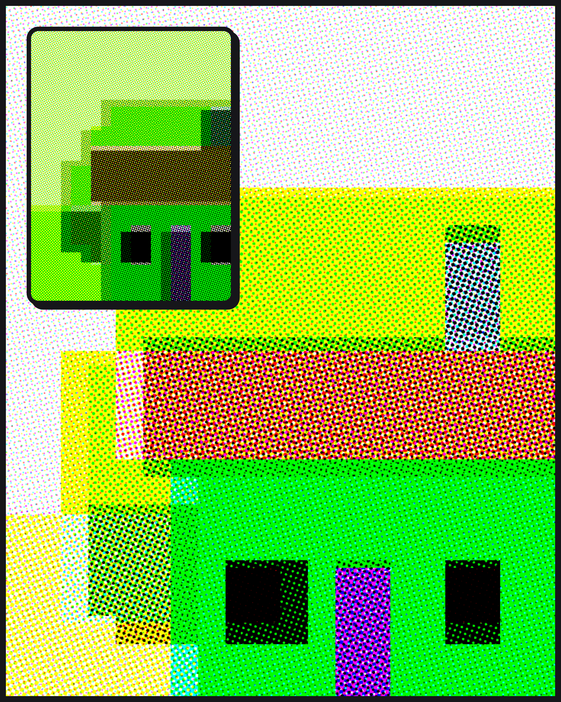

*Một tác phẩm thật xuất từ app: PiP layout + Halftone filter + star sticker*

</div>

---

## 📑 Mục lục

- [✨ Tính năng](#-tính-năng)
- [📱 Screenshots](#-screenshots)
- [🎨 Phong cách Comic UI](#-phong-cách-comic-ui)
- [🏗 Kiến trúc](#-kiến-trúc)
- [🚀 Cài đặt & chạy](#-cài-đặt--chạy)
- [🧪 Tests](#-tests)
- [🔧 Stack kỹ thuật](#-stack-kỹ-thuật)
- [🗺 Roadmap](#-roadmap)

---

## ✨ Tính năng

### 📷 Duo Capture — chụp đôi một nhịp
- Chạm **SNAP!** lần 1 → chụp **camera sau**
- App **tự động lật sang camera trước** với overlay chữ **"TIẾP!"** kiểu truyện tranh
- Chạm **SNAP!** lần 2 → chụp **camera trước** → bay thẳng vào editor
- Cho phép **chụp lại từng slot** (cam sau / cam trước) bất cứ lúc nào
- Tự nhận diện thiết bị thiếu camera trước/sau và báo bằng snackbar thay vì crash

### 🖼 Custom Duo Layout — 10 kiểu ghép
| Layout | Mô tả |
|---|---|
| **Chia dọc** | 2 panel trái/phải, kéo slider đổi tỉ lệ 25/75 ↔ 75/25 |
| **Chia ngang** | 2 panel trên/dưới, cũng chỉnh được tỉ lệ |
| **Chéo /** & **Chéo \\** | Cắt chéo kiểu splash page truyện tranh (clip theo đường chéo) |
| **PiP × 4 góc** | Ảnh sau full-bleed, ảnh trước làm panel nhỏ lồng ở 1 trong 4 góc, có viền comic + shadow cứng |
| **Truyện 3 ô** | Comic page: wide-shot trên full-width + 2 ô dưới (cam trước + crop ảnh sau), gutter trắng viền đen |
| **Truyện 4 ô** | Comic page lưới 2×2 so le ảnh sau/trước — đúng chất một trang truyện tranh |

Bonus trong tab Layout: nút **hoán đổi (swap)** vị trí 2 ảnh, và slider tỉ lệ live-update.

### 🎞 Comic Filters — 8 filter xử lý pixel thật
Filter chạy trong **isolate riêng** (không lag UI), cache theo từng ảnh, áp cho cả 2 tấm cùng lúc.
Kèm **slider ĐỘ MẠNH** (10–100%): blend pixel-wise giữa ảnh gốc và ảnh đã filter ngay trong isolate,
cache theo nấc 10% nên kéo slider mượt:

| Filter | Hiệu ứng |
|---|---|
| **GỐC** | Ảnh nguyên bản |
| **POP!** | Màu rực, tương phản cao (saturation + contrast boost) |
| **HALFTONE** | ⭐ Chấm in truyện tranh **CMYK thật** (color halftone theo kênh màu) |
| **CARTOON** | Posterize kiểu hoạt hình |
| **NOIR** | Đen trắng + vignette kiểu detective comic |
| **VINTAGE** | Sepia phim cũ |
| **CHILL** | Tone lạnh mát |
| **HEAT** | Tone nóng rực |

### 💥 Stickers & Speech Bubbles
Catalog **13 sticker vector** vẽ bằng CustomPainter (không cần asset ảnh):
- **Burst words**: POW!, BOOM!, ZAP!, WOW!, OMG!, SNAP! — ngôi sao bùng nổ 12 cánh
- **✍️ Burst TỰ VIẾT**: gõ action word riêng của bạn (auto uppercase kiểu comic) — ô đầu tiên trong hộp sticker
- **Bong bóng thoại**: oval / rectangle / **cloud thought bubble** — **edit text trực tiếp** (burst cũng edit được)
- **Shapes**: star, lightning bolt, heart, smiley

Mỗi sticker trên canvas hỗ trợ full gesture:
- **1 ngón kéo** để di chuyển
- **2 ngón pinch** để zoom (0.3× – 4×)
- **2 ngón xoay** để rotate
- Nút **×** đỏ để xoá, nút **"Xoá hết"** reset canvas

### 🖼 Khung (Canvas Aspect)
Đổi tỉ lệ khung xuất: **1:1** (Instagram), **4:5**, **3:4** — canvas re-layout live.

### ↩️ Undo/Redo toàn bộ editor
Mọi thao tác (layout, tỉ lệ, khung, swap, filter + intensity, sticker thêm/xoá/sửa/kéo/pinch) đều
undo/redo được bằng nút trên AppBar — snapshot state, throttle gộp gesture liên tục, tối đa 60 bước.

### 🎬 GIF Comic — export hoạt hình
Nút **GIF!** render canvas thành **animated GIF 8 frame**: hiệu ứng zoom-punch luân phiên giữa
2 panel kèm shake nhẹ — kiểu "hoạt hình truyện tranh". Encode thuần Dart (`image` package) trong
isolate, lưu thẳng vào gallery, share được ngay.

### 💾 Export thật — WYSIWYG
- Render lại **toàn bộ canvas** (ảnh đã filter + layout + sticker vector) qua `RepaintBoundary` ở độ phân giải ~2000px
- **SAVE!** → lưu PNG vào album **`Pictures/DuoComic`** (Android) / Photos (iOS) qua [`gal`](https://pub.dev/packages/gal)
- **SHARE!** → mở system share sheet kèm caption "Duo Comic Camera!"

---

## 📱 Screenshots

*Tất cả ảnh dưới đây chụp trực tiếp từ app chạy thật trên Android emulator (Pixel, Android 15), không mock, không chỉnh sửa.*

| Capture | Editor + Split | Halftone filter |
|---|---|---|
| 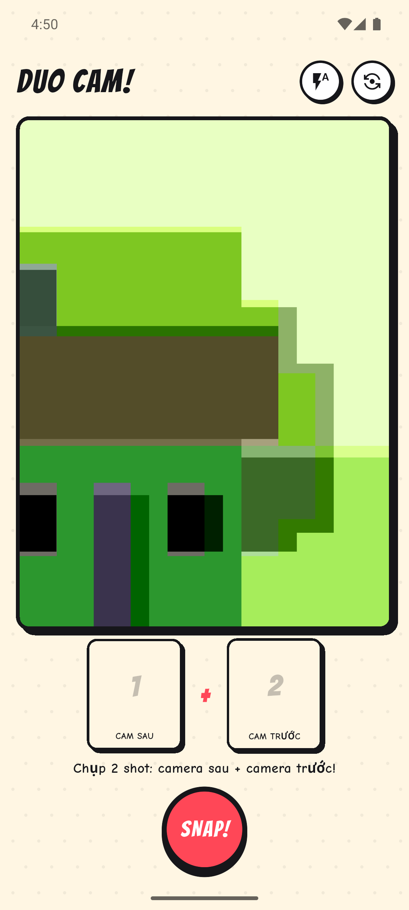 | 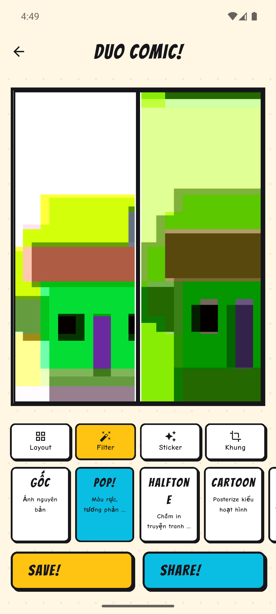 | 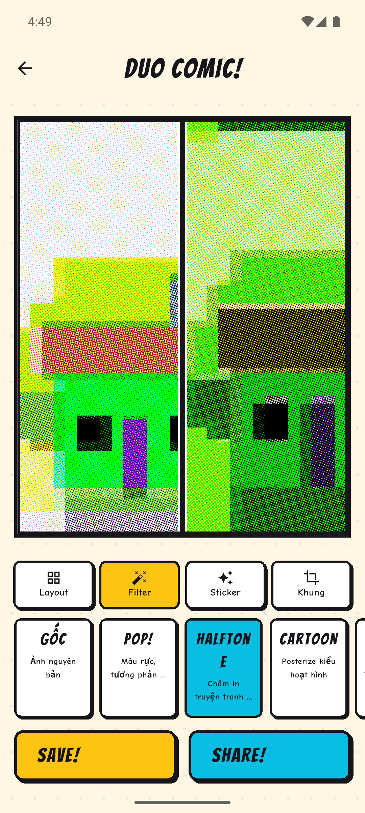 |
| Màn chụp: SNAP! + 2 slot cam | Editor chia dọc + gutter truyện tranh | Chấm CMYK in truyện tranh thật |

| PiP layout | Sticker kéo-thả | Share sheet |
|---|---|---|
| 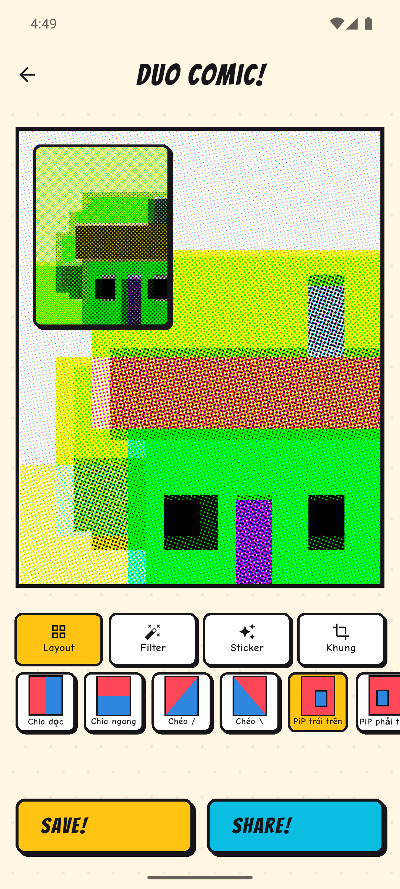 | 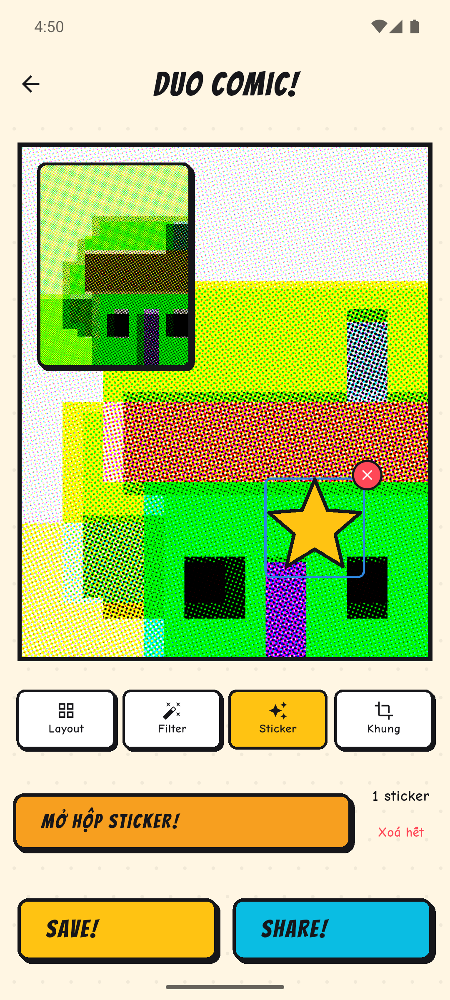 | 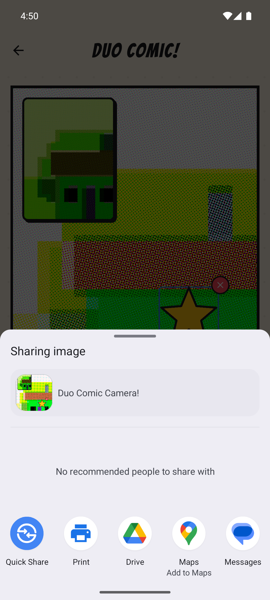 |
| Panel nhỏ viền comic ở góc | Star sticker + selection box | Share sheet hệ thống thật |

| Khung 1:1 | Burst TỰ VIẾT | Hộp sticker |
|---|---|---|
| 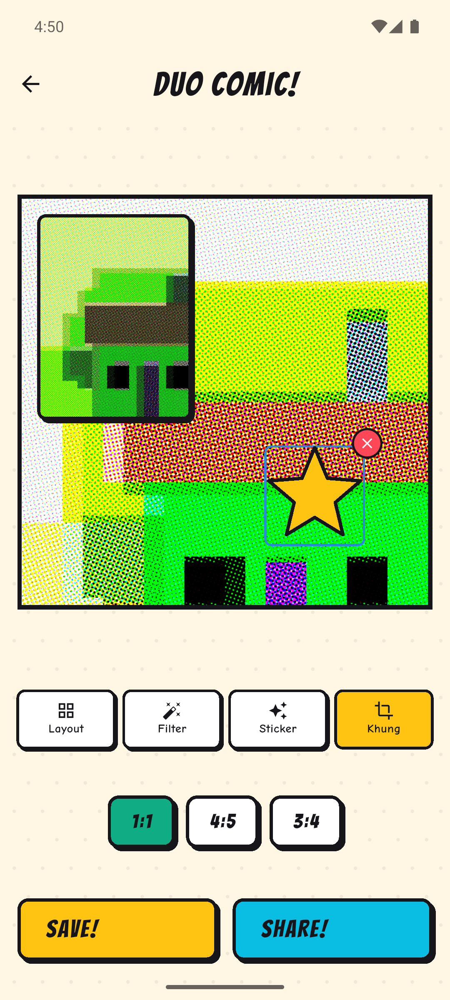 | 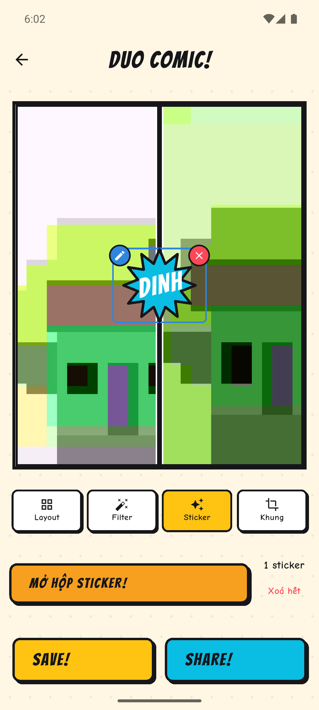 | 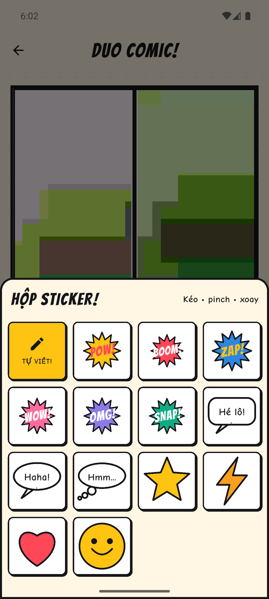 |
| Đổi aspect canvas live | "dinh" → **DINH** auto uppercase | Catalog 13 sticker + ô TỰ VIẾT! |

| Truyện 3 ô | GIF comic | |
|---|---|---|
| 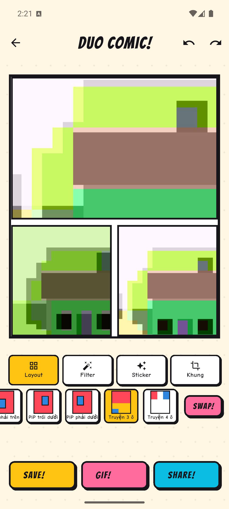 | 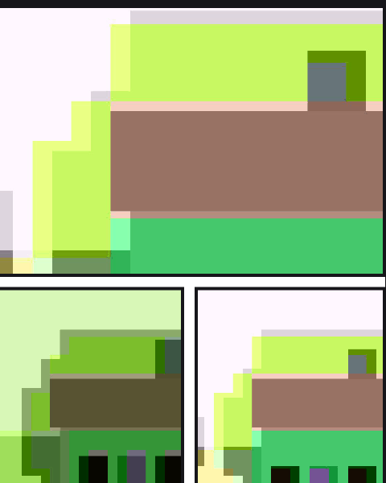 | |
| Comic page: wide-shot + 2 ô dưới | GIF 8 frame zoom-punch xuất thật từ app | |

---

## 🎨 Phong cách Comic UI

- **Font display**: [Bangers](https://fonts.google.com/specimen/Bangers) — kiểu title truyện tranh Mỹ
- **Font body**: [Comic Neue](https://fonts.google.com/specimen/Comic+Neue) bold
- **Palette**: giấy kem `#FFF6E3` + chấm halftone nền, mực đen `#16161A`, màu spotlight rực (đỏ/vàng/xanh/hồng/tím)
- **Panel**: viền đen dày 3–4px + **shadow cứng offset** (không blur) — đặc trưng in ấn retro
- **Nút bấm**: uppercase action-word (`SNAP!`, `SAVE!`, `MỞ HỘP STICKER!`), nhấn xuống **lún 3px** như nút thật
- Toàn bộ text UI bằng **tiếng Việt**

---

## 🏗 Kiến trúc

```
lib/
├── main.dart                  # entrypoint, portrait lock, SystemUI comic style
├── app.dart                   # MaterialApp + ComicTheme
├── theme/
│   └── comic_theme.dart       # palette, panel/shadow, ComicButton, halftone background
├── capture/
│   └── capture_screen.dart    # duo sequential capture, auto-flip, slot thumbnails,
│                              #   strict camera lookup + missing-camera snackbar
├── editor/
│   ├── editor_screen.dart     # tabs Layout/Filter/Sticker/Khung, SAVE!/SHARE!
│   ├── editor_controller.dart # state: filter cache, layout, stickers (injectable runner)
│   ├── duo_canvas.dart        # RepaintBoundary canvas: photo regions, divider,
│   │                          #   PiP inset, diagonal clip, panel frame
│   ├── layouts.dart           # 8 DuoLayout + computeRegions + rotateOffset math
│   ├── filters/
│   │   └── comic_filters.dart # 8 filters trên package:image, compute() isolate pipeline
│   └── stickers/
│       ├── sticker_model.dart # catalog 13 sticker + placement state
│       ├── sticker_art.dart   # CustomPainter: burst/bubble/shape (vector, no assets)
│       ├── sticker_layer.dart # gesture layer: drag/pinch/rotate/delete
│       └── sticker_picker.dart# bottom sheet sticker catalog + bubble text editor
└── export/
    └── exporter.dart          # boundary.toImage(pixelRatio) → PNG → gal / share_plus
```

**Quyết định thiết kế đáng chú ý:**
- *Duo sequential* thay vì concurrent: plugin `camera` không hỗ trợ 2 stream đồng thời trên đa số thiết bị → app chụp nối tiếp với auto-flip để trải nghiệm vẫn "một nhịp".
- *Sticker vector thay vì PNG asset* → export qua `RepaintBoundary` luôn sắc nét ở mọi pixelRatio, sticker scale không vỡ.
- *Filter trên bytes gốc trong isolate*, cache `(ảnh, filter)` → chuyển filter instant sau lần đầu.
- Ảnh chụp được `bakeOrientation` (xoay theo EXIF) trước khi filter → không bị lật/ngả.

---

## 🚀 Cài đặt & chạy

### Yêu cầu
- Flutter **3.47+** (Dart 3.13+)
- Android: minSdk **24** (Android 7.0), compileSdk 37 · iOS: 13.0+
- Thiết bị/emulator có **cả camera trước lẫn sau** (app kiểm tra và báo nếu thiếu)

### Chạy
```bash
git clone https://github.com/dan-tech-academy/duo-comic-camera.git
cd duo-comic-camera
flutter pub get
flutter run                 # debug trên device/emulator đang kết nối
flutter build apk --debug   # build APK
flutter build ios           # iOS (cần macOS + Xcode)
```

### Quyền runtime
| Platform | Quyền | Dùng cho |
|---|---|---|
| Android/iOS | **Camera** | chụp duo |
| Android/iOS | **Photos/Storage (add-only)** | SAVE! vào thư viện (`NSPhotoLibraryAddUsageDescription`) |

Đã khai báo sẵn trong `AndroidManifest.xml` và `ios/Runner/Info.plist` (tiếng Việt).

---

## 🧪 Tests

```bash
flutter test                                    # 32 unit/widget tests passing

# Integration test trên emulator/device thật (verify pinch/rotate sticker
# bằng gesture multitouch — thứ không inject được qua adb):
adb shell pm grant com.dantech0xff.duo_comic_camera android.permission.CAMERA
flutter test integration_test -d <device>      # capture duo thật → pinch + rotate
```

- `test/comic_filters_test.dart` — pixel math của từng filter (saturation, grayscale, sepia, vignette…)
- `test/layouts_test.dart` — `computeRegions` cho 8 layout, tỉ lệ split, diagonal clip, rotate math
- `test/editor_controller_test.dart` — filter cache, swap, sticker transform, runner injectable (không isolate trong test)
- `test/widget_test.dart` — smoke test editor: chuyển layout, đổi filter, thêm sticker, đổi khung

---

## 🔧 Stack kỹ thuật

| Package | Vai trò |
|---|---|
| [`camera`](https://pub.dev/packages/camera) | preview + takePicture 2 lens |
| [`image`](https://pub.dev/packages/image) | filter pipeline (halftone/sepia/contrast…), bake EXIF |
| [`gal`](https://pub.dev/packages/gal) | lưu PNG vào gallery/photos |
| [`share_plus`](https://pub.dev/packages/share_plus) | share sheet hệ thống |
| [`permission_handler`](https://pub.dev/packages/permission_handler) | xin quyền camera |
| [`provider`](https://pub.dev/packages/provider) | state management nhẹ |

---

## 🗺 Roadmap

- [ ] Chụp **đồng thời** 2 camera trên thiết bị hỗ trợ multi-camera API
- [ ] Video duo / GIF reaction
- [x] ~~Burst-word tự gõ text~~ ✅ v1.1
- [ ] Template khung truyện tranh nhiều panel (3–4 ô)
- [ ] CI build APK/IPA qua GitHub Actions

---

<div align="center">

Made with 💥 bởi [dantech0xff](https://github.com/dantech0xff) + Devin

**POW! BOOM! CHỤP ĐI!**

</div>
